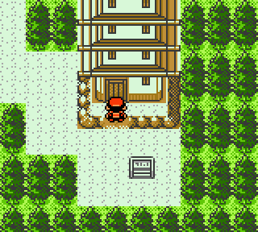
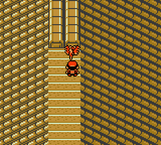
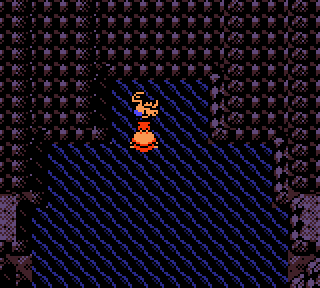
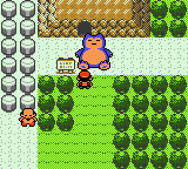
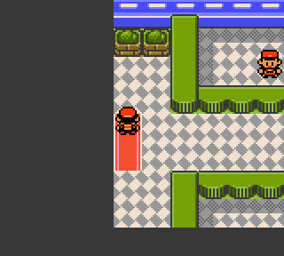

# Crystal Auto Reset

Automatic shiny soft-reset hunts for Suicune, Ho-Oh, Lugia and Snorlax, plus a roaming Raikou/Entei finder, in the English 3DS Virtual Console release of Pokémon Crystal on Luma3DS.

**No RNG manipulation.** These plugins only automate soft resets: they press the same buttons you would, with a randomised human-like delay, read the encounter's DVs once the game has rolled them, and reset if it isn't shiny. They never write to the game's RNG, timers, clock, save or Pokémon data, and never time an input to hit a chosen result. Every Pokémon is generated by the game at normal odds (1 in 8,192), exactly as in a manual soft-reset hunt.

Built on the frozen Reset v1.0.0 method from [CelebiHunter](https://github.com/Kou1236/CelebiHunter) by Kou1236, modified in November 2026 by ilex-labs. This is not an official CelebiHunter release. For shiny Celebi, use CelebiHunter's own [Reset v1.0.0](https://github.com/Kou1236/CelebiHunter/releases).

> [!IMPORTANT]
> Pokémon Bank closes on [**February 26, 2027**](https://en-americas-support.nintendo.com/app/answers/detail/a_id/61543/~/pok%C3%A9mon-bank-service-update), and transfers from Bank to Pokémon HOME end with it. Crystal VC Pokémon reach HOME through Poké Transporter → Bank → HOME, so finish these hunts before then.

## Builds

| Build | Encounter | What it automates | Hardware result |
|---|---|---|---|
| `Suicune.3gx` | Suicune, Tin Tower 1F, Lv40 | Walks up into the Tin Tower door | Shiny after 895 attempts |
| `HoOh.3gx` | Ho-Oh, Tin Tower roof, Lv60 | One A press on Ho-Oh | Shiny after 6,162 attempts |
| `Lugia.3gx` | Lugia, Whirl Islands, Lv60 | One A press on Lugia | Shiny after 11,425 attempts |
| `Snorlax.3gx` | Snorlax, Vermilion City, Lv50 | Tunes the Pokégear radio to the Poké Flute channel, then A through the wake-up text | Shiny after 7,133 attempts |
| `BeastFinder.3gx` | Raikou and Entei, roaming, Lv40 | Steps out of the Route 38 gate, reloads until a beast moves onto Route 38, paces the grass under Repel, then stops on the encounter so you can catch it | Found both beasts |

`BeastFinder` does not shiny hunt. It stops on the first Raikou or Entei encounter, shiny or not, and hands over to you. It saves you the tedium of tracking a roamer down.

Each attempt: the plugin picks Continue on the title screen, loads your save, runs the target's input sequence, reads the DVs once the battle has started, and soft resets on a non-shiny. A shiny stops the loop on the battle screen. The plugin never saves; catching and saving are up to you.

**Install one build at a time.**

## Compatibility

- English Pokémon Crystal Version for 3DS Virtual Console, title ID `0004000000172800`
- Luma3DS with Plugin Loader enabled
- Tested on a New 3DS LL in normal CPU mode with Luma3DS 13.4. CelebiHunter's Reset v1.0.0, which these builds are based on, also runs on Old 3DS, Old 2DS and New 2DS, and in 804 MHz mode; these builds have not been tested there. Reports are welcome through GitHub Issues.

Japanese Crystal is **not supported**.

## Before you start: the save point

Every attempt reloads your in-game save, so the save decides where the plugin starts. Save at the exact spot below for your target. The pictures were taken during a test run of the plugins in an emulator (see [Dry run](#dry-run-in-an-emulator)). If the plugin finds you anywhere else, it stops and tells you on screen instead of pressing anything.

### Suicune



- You haven't battled Suicune at Tin Tower yet, and you can reach the tower's door.
- Stand on the tile directly below the door of Tin Tower itself, **facing up** at the door, and save. This is the tower's own door in the northeast of Ecruteak City, past the gatehouse with the sages, not the gatehouse door.
- To face the door without walking in, step down one tile and back up.
- The plugin presses Up to walk in. The game's own cutscene moves you to Suicune and starts the battle.

### Ho-Oh



- Stand on the Tin Tower roof on the tile directly below Ho-Oh, **facing up** at it, and save.
- The plugin presses A once.

### Lugia



- Lugia sits in the water, so **Surf** up to the tile directly below it, **facing up** at it, and save while still surfing.
- The plugin presses A once.

### Snorlax



- You need the Pokégear's radio card (the Expansion Card from Lavender Radio Tower).
- Snorlax is two tiles wide. Stand on the tile directly below its **left half**, **facing up**, and save. The tile below the right half is not accepted.
- You don't need to turn the radio on before saving. The radio doesn't survive a reload, so the plugin tunes it every attempt.
- The plugin opens the Start menu, opens the Pokégear, tunes the radio to the Poké Flute channel (20.0), closes the menus, then presses A and advances the wake-up text.

### Raikou and Entei (BeastFinder)



- Raikou and Entei must already be roaming (released at the Burned Tower).
- Put a Pokémon between **Lv17 and Lv40** in the first party slot, not fainted. Route 38's wild Pokémon are Lv16 or below and the beasts are Lv40, so with a Repel on, only a beast can appear.
- Use a **Max Repel** just before saving (a Super Repel also works). The save needs at least 120 Repel steps left, so a plain Repel (100) is not enough. Each attempt reloads the save, so the Repel is back to full every time.
- Walk from Route 38 into the gate between Route 38 and Ecruteak City. Save on the tile you arrive on, the mat just inside the Route 38 door (one step further in also works). Facing doesn't matter.
- The plugin steps out onto Route 38 once. If no beast has moved onto the route, it resets and reloads, which scatters the beasts again. When one is on Route 38, it walks to the grass just outside the gate and paces it until the encounter starts.
- Be ready when the battle starts. Raikou and Entei always run on their turn unless they're trapped (Mean Look or Spider Web), asleep or frozen. A Ball thrown on your first turn always goes before they can run; a move only does if your Pokémon is faster.

### If the plugin stops before starting

| Message | Fix |
|---|---|
| `Save not below Tin Tower door` | Suicune: save on the tile below the tower's own door, facing up. |
| `Save not facing legendary` | Ho-Oh, Lugia or Snorlax: save on the tile directly below it (Snorlax's left half), facing up. |
| `Save not at gate's Route 38 exit` | BeastFinder: save on the Route 38 mat inside the gate, or one step in. |
| `Use a Max Repel, then save` | BeastFinder: use a Max or Super Repel right before saving. |
| `Lead must be Lv17-40` | BeastFinder: put a Lv17–40 Pokémon that isn't fainted first in the party. |
| `No unmet beast is roaming` | BeastFinder: neither beast is roaming in this save. |
| `Map mismatch; see values` | The save is on the wrong map for this build. |

## Installation

1. Save at the start position for your target (see above).
2. Close the game, make a Checkpoint backup, and keep an untouched copy on a computer.
3. Download the `.3gx` for your target from the latest GitHub release.
4. Copy it to:

   ```text
   sd:/luma/plugins/0004000000172800/
   ```

5. Make sure that folder contains only one `.3gx` file.
6. Open Rosalina with `L + D-Pad Down + Select` and enable **Plugin Loader**.
7. Launch Pokémon Crystal and leave the controls alone.

## Controls

- **Non-shiny:** starts the next attempt automatically.
- **Shiny:** stops on the battle screen and shows the DVs.
- `B`: stops automation.
- `R`: after a shiny or a stop with `B`, gives control back and hides the plugin's text. Then catch it and save yourself.

If anything unexpected happens (you're off the start tile, the wrong map loads, a menu doesn't open), the plugin stops with a message rather than guessing. Two cases reset and try again instead, since nothing has been met yet: BeastFinder when no beast arrives or the Repel runs low, and Snorlax when a radio step fails (it stops after three failures in a row).

## After transferring

Poké Transporter converts Generation II Pokémon: DVs are not carried over, IVs and Nature are set at transfer, your OT and Trainer ID stay, and they arrive with the Game Boy origin mark. Shininess is kept. Full rules: [Poké Transporter on Bulbapedia](https://bulbapedia.bulbagarden.net/wiki/Pok%C3%A9_Transporter#From_Generation_I_and_II).

## Disclosure when sharing

Pokémon from these builds are auto-hunted. Say so where it matters: r/ShinyPokemon requires it, and r/pokemontrades does not allow automated catches.

## How it is built

Every build comes from the same code, CelebiHunter's Reset v1.0.0 core, with a build option (a "Cargo feature") that picks the target: the start map and tile, the target species and level, and the input sequence. The rest of the Reset logic is unchanged: the same human-like input timing, DVs read and confirmed in the battle before deciding, and a reset only after a confirmed miss.

The shared Rust core still contains CelebiHunter's older RNG code. No build in this repository enables it, and the build script rejects any binary that links it. CelebiHunter's separate RNG build is not included here.

To build from source, see [docs/BUILDING.md](docs/BUILDING.md). Each binary used in the hardware hunts above rebuilds byte-for-byte from the commit that added or last changed its target; the hashes are listed there.

## Dry run in an emulator

[`tools/dryrun/`](tools/dryrun/) runs the plugins' own decision code against Pokémon Crystal in an emulator. The game is built from the [pret/pokecrystal](https://github.com/pret/pokecrystal) disassembly and runs in [PyBoy](https://github.com/Baekalfen/PyBoy). The plugin logic is the same Rust that goes into each `.3gx`, compiled for a computer instead of the 3DS.

In testing, Suicune, Ho-Oh, Lugia and Snorlax each ran 301 attempts without a stall: every attempt reached the battle, read the DVs and reset. With shiny DVs written in on purpose (a test hook in the script, not something the plugins do), each one stopped on the shiny. BeastFinder found a beast in 8 out of 8 runs.

This doesn't test the 3DS side: the Virtual Console hook, button injection and console timing. The hardware hunts above cover that.

## AI disclosure

This project was written with [Claude](https://claude.ai), Anthropic's AI assistant. The maintainer decided what to build and tested every listed build on a real console, but doesn't review the code line by line.

## Documentation

- [Building](docs/BUILDING.md)
- [Dry run in an emulator](tools/dryrun/README.md)
- [Backup and recovery](docs/SAFETY.md)
- [Contributing](CONTRIBUTING.md)

## License

GNU GPL v3.0 or later, the same as CelebiHunter. See [LICENSE](LICENSE). This is a modified version of CelebiHunter, changed in November 2026; the original is at [Kou1236/CelebiHunter](https://github.com/Kou1236/CelebiHunter).

## Credits

- [CelebiHunter](https://github.com/Kou1236/CelebiHunter) by Kou1236: the Reset v1.0.0 engine every build here is based on.
- [PokeReader](https://github.com/zaksabeast/PokeReader) and [Pokémon RNG Guides](https://github.com/zaksabeast/PokemonRNGGuides) by zaksabeast: game reading and Crystal research that CelebiHunter builds on.
- [pret/pokecrystal](https://github.com/pret/pokecrystal): Crystal disassembly and symbols, and the game build used by the dry run.
- [PyBoy](https://github.com/Baekalfen/PyBoy): the Game Boy emulator used by the dry run.
- [Pan Docs](https://gbdev.io/pandocs/) by gbdev: Game Boy hardware documentation.
- [Luma3DS](https://github.com/LumaTeam/Luma3DS) by LumaTeam: the 3GX plugin loader and Rosalina.
- [CTRPluginFramework](https://gitlab.com/thepixellizeross/ctrpluginframework) by The Pixellizer Group and [Blank Template](https://github.com/PabloMK7/CTRPluginFramework-BlankTemplate) by PabloMK7: plugin interfaces and 3GX build references.
- [gsclua](https://github.com/wwwwwwzx/gsclua) by wwwwwwzx: the Route 38 spot for the roaming beasts (idea only, no code).
